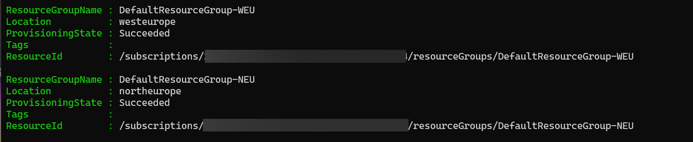
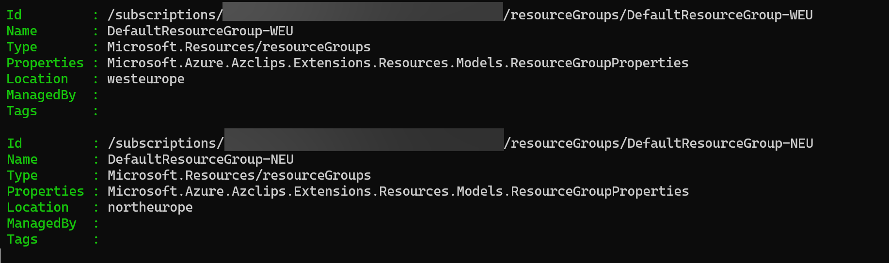
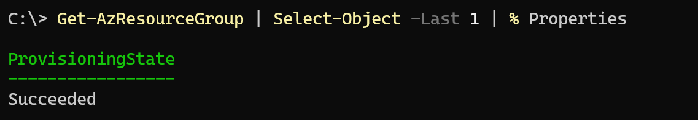
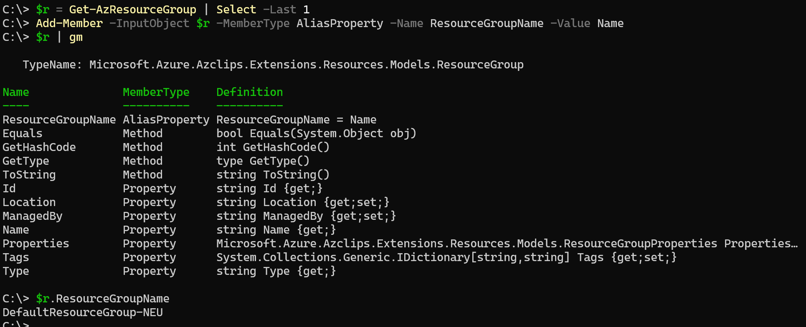
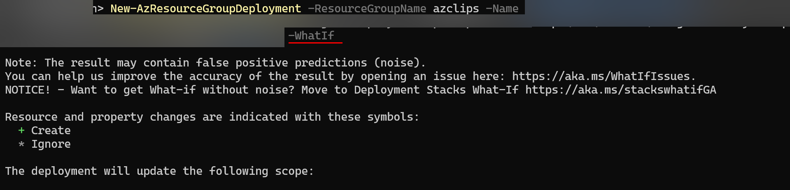
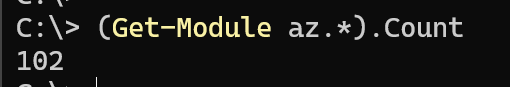
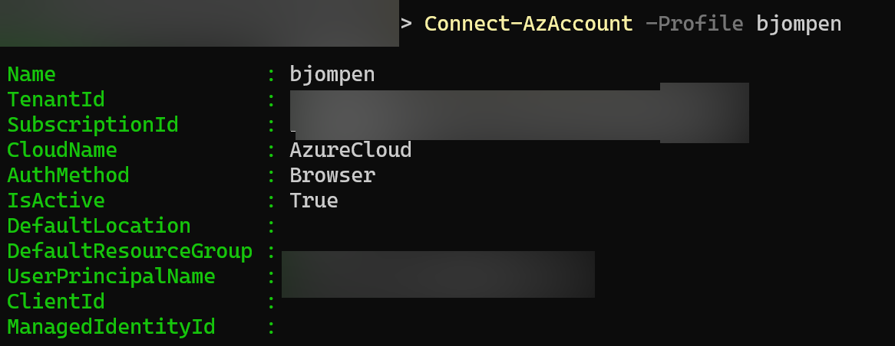
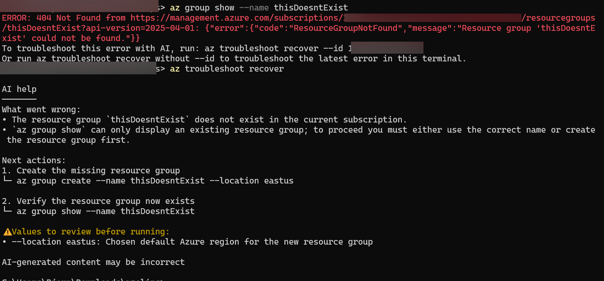
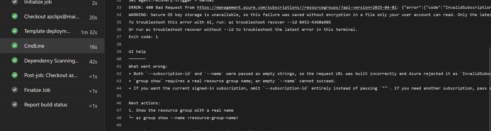
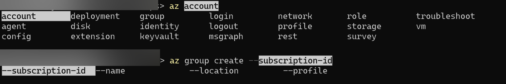

# Azclips

2026 was a good year for my MVP title. I got my first blue ring - the honourable one marking five years in the program. I really can't believe it has actually been five years. Tt feels more like I joined maybe 2years ago. You know, about as long time ago as 2010 was? right? 

There are a lot of good stuff we get as MVPs. Free Azure credits. GitHub Copilot. 365 licenses. Inside info on "the next big thing". But honestly, these are not my favourite part of it - Contact with product teams are.

We get to meet and talk to the product teams directly, and sometimes we even get invited to play with the new toys and take part in the actual development of them.

And that, my friends, is why we are here today!

Azclips - released today. And I've been a part of it since the first private preview.

## So what is Azclips?

The short version: azclips is the new and next version of the [az cli](https://learn.microsoft.com/cli/azure?wt.mc_id=DT-MVP-5005317) as well as [Azure PowerShell](https://learn.microsoft.com/powershell/azure?wt.mc_id=DT-MVP-5005317). But it hides a whole lot more than that.

IT is actually a rewrite of the entire backend of both of these platforms, made in order to better combine development and release cadence of both products. Instead of two teams managing two things with the possible configuration drift and difference that means, one team handles it all with a shared backend code base. 

This (logically) requires a major rewrite of both platforms, so while the names as well as functionality may be the same, there is a lot of changes behind the scenes. 

Most of the time I don't really care about "behind the scenes" though - we care about what we see and use, so lets dig in to some of the good, some of the bad, and some of the ugly coming with this brand new old product.

## The ugly

"Wait what?" I hear you say. "It's 'the good, the bad, and the ugly', not the other way around!". You are correct.
However, ending with the downsides often makes it so that that is what you remember, leading you to thinking this is a bad product. It isn't. But it has some downsides. For me, the biggest ones are changes in in- and output, and behaviour.

### Output

Some of the places I have argued with developers are in output format and output properties.

Let's do a comparison of the command `Get-AzResourceGroup` - First of we have the old output (version 16)



And then from azclips PowerShell version (0.1.17)



We may argue that we get more information in the new one although some properties change location. For example, ProvisioningState is what hides under the `Properties` property here.



Location and Tags are both there, but what is worth noting is that the properties `ResourceGroupName` and `ResourceId` have changed property name to `Name` and `Id` respectively. Although I do agree the new names are, in fact, better, I would classify this as "change for the sake of change". I do not think the name changes add value; it just adds compatibility issues. In PowerShell this would be an easy fix by adding AliasProperties, but in the current release this isn't done.



This pattern can be found on many different types - and will cause unnecessary issues with existing code. 

While this may affect the cli as well, I am a PowerShell person, and not making use of the fact that PowerShell uses objects not text (unlike said cli) causes some ugly side effects.

### Input 

The same pattern (or anti-pattern) is seen in input as well - Changes for the sake of changes, that according to me doesn't add value. Take, for example, the command `New-AzResourceGroupDeployment`. In versions up to 16 one command format for deploying a Bicep template is this:

```PowerShell
New-AzResourceGroupDeployment -ResourceGroupName $rg -Name $deployment -TemplateFile $template -TemplateParameterObject @{name = 'parameterValue'}
```

In azclips, the closest we get (so far) is this:

```PowerShell
New-AzResourceGroupDeployment -ResourceGroupName $rg -Name $deployment -TemplateFile $template -Parameter 'name=azclips'
```

Spot the differences? Instead of a template parameter object we have a string as input, and the parameter name is `Parameter` instead of `ParameterObject`. In fact, where we currently have the options `TemplateParameterObject`, `TemplateParameterFile` , and `TemplateParameterUri` for parameter input, azclips gives us the following: `Parameter`, `ParametersUri`, `ParametersFile`. Apart from the verbs in singular and plural the names are changed. Just like before the new ones does make sense, but we have aliases for parameters as well. Use them.

### Behaviour

A bit shorter, but still, something that I believe will cause issues: Some CmdLets change behaviour. Once more, to the more logical solution, but non the less it will be worth knowing.

In earlier versions of the Azure PowerShell command(s) for deployment, a `-WhatIf` performed a WhatIf deployment. You got the Azure WhatIf information back. In azclips it performs the more traditional PowerShell WhatIf action - outputs "this is what I would have done"




# The bad

Missing functionality. That's it. That's the bad.

As of this point in time there is _a lot_ of missing functionality. Let's do a comparison of modules available. I start with importing the `az` module, then count all the `az.*` modules (the ones containing actual functionality).

In the current version we have 102 modules



and in azclips we have.. (drumroll).. 9.


That's no less than 93 missing modules.

There is also functionality and CmdLets missing in the modules available - for example the current Az.Compute contains 287 CmdLets and the azclips version has 5.

This is of course just a current problem - modules will be added, and I actually expect this to be quite fast, but currently this may be problematic for testing and validating your current automations.

Apart from this, I do feel like PowerShell has been put a bit behind as we are also missing one of the key features of azclips: **There is currently no way of calling the AI help from a PowerShell CmdLet**

Which, ironically, leads me to the good stuff..

## The good

Like I said above - I may sound negative, but that is not my point. This is a _great_ improvement over earlier versions, and I'm going to go through the three things that has me convinced.

### 1. Profiles

Thank. God.

I am a consultant by daytime. This means I work in a lot of different environments, sometimes multiple different per day. The current login experience for this is something of a nightmare. Remembering TenantIds, SubscriptionIds, handling multiple logins (running `Disconnect-AzAccount` about 20 times before doing anything to be sure is more or less a standard thing). Starting every session with `Get-AzResourceGroup | % ResourceGroupName` to make sure I am in the right sub.

Enter profiles. The new login experience in and by itself isn't much different, but a new parameter enters the scene: -Profile



Creating a profile is as simple as the old login is (yes yes, not simple) but add a parameter: `Connect-AzAccount -TenantId <myTenantId> -SubscriptionId <mySubscriptionId> -OutProfile myFirstProfile`.

Next time you want to log in, you simply do `Connect-AzAccount -Profile myFirstProfile` and it will use the previously saved information. 

You can also use `Set-AzProfile` to change between profiles - both different tenants but also things like juggling subscriptions. `Set-AzProfile -Name 'Customer1-Management-LandingZone'` is just crazy better than the old way (Get-AzSubscription -> Set-AzContext).

Seriously - this feature alone is worth the switch.

### 2. AI assisted error solving

Yes, I am no big fan of AI. It burns rainforests and kills animals for the sake of being confidently wrong.. But it can actually be somewhat helpful.

Like I said above - This feature is not yet possible to use in PowerShell - you have to use az cli. Fortunately, the login experience here is just as good as in PowerShell: Just run `az login --profile bjompen` (Profile name may vary - use bjompen at your own risk) and no more remembering ids.

AI Based error handling is a voluntary process. By default it is not enabled at all - you have to enable it using the command `az config set --key agent.recovery.trigger --value manual`. Value can be 'off', 'manual', or 'trigger', where 'trigger' will send all errors to the AI thingamajig, and manual requires you to send them.

So what does it look like? Let's fail, shall we!



Stepping through the process - we first have an issue ("Resource group doesn't exist"). We can now of course debug and dig through the message and figure it out, but we can also choose to run `az troubleshoot recover` to automatically send the last error to Azure AI thing. Add `--id <error id>` to look at an older issue.

Oh, and to make it even better:
- You can bring your own models to it
and
- It works in a pipeline as well!



Like I said, I am no fan of AI, and I do not think this should be default on - If you can't figure out what "Resource group not found" means we have other issues - But every now and then we get errors that are not as easy to figure out, and this will add another tool in the toolbox.

And also, I have still never heard anyone say "This is to many hints on where my issue is, can you make it somewhat harder to solve?"

### 3. az cli autocomplete

So, last, but not least: the az cli has auto complete. It has to be enabled, and it does mess with your PSReadlineKeyHandlers (the underlying scripts that makes tab completion in PowerShell work), but it works.

I rarely use the cli. I prefer PowerShell. But when I do I was always terribly annoyed that I couldn't easily get help on what the next thing should be. Now I can.

type `az`, click `ctrl+space` to get the menu seen below, or just `tab` to type it out on screen (if you're on Windows. Mac and Linux behave different, but autocomplete works everywhere), select the things you want, `ctrl+space` again to get a list of what's next.



Is it flawless? no. For example, unlike in PowerShell, it still can't autocomplete values, so if I select `--profile` and click tab again I just get the next possible parameter. But it is extremely useful. It helps me not having to remember stuff - and not remembering stuff is my favourite thing to not do.

## Summary

So, in summary - azclips.

I am really happy to have been a part of the creation of it, and I do think my contributions can make a big difference. I am also really happy with how it is turning out. Most of the issues I have are things that actually does makes sense, I just need to not be an old fart about it.

Let's take an older example: When Azure AD became Entra ID. I, and many people with me, had a hard time changing names - but in reality it was never an AD and never should have been. In the same way, maybe a `New-AzResourceGroupDeployment -Whatif` should never have not been a normal PowerShell Whatif. 

And features - well - there are a lot of things missing, but they will come, no rush.

There will be _a lot_ of code to be checked, refactored, add `#requires` statements, update runners...

But in the end it will be worth it.

Because, if nothing else: `Connect-AzAccount -Profile bjompen`
